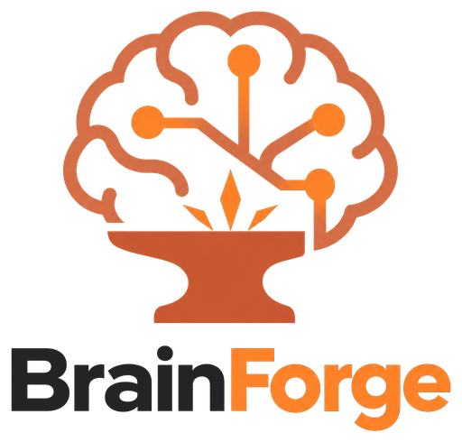

<p align="center">
  <picture>
    <source media="(prefers-color-scheme: dark)" srcset="docs/assets/logo-dark.png">
    
  </picture>
</p>

<p align="center"><b>Git-native, agentic knowledge management.<br>Knowledge as Code, managed through GitOps.</b></p>

BrainForge turns documents into a structured, versioned knowledge base, called a **brain**, that AI agents build, maintain and query. Each brain is a plain Git repository. Knowledge is stored as an [Open Knowledge Format (OKF) v0.2](https://github.com/GoogleCloudPlatform/open-knowledge-format/blob/main/SPEC.md) bundle: Markdown files with YAML frontmatter that you can read without any tooling.

## Highlights

| | |
|---|---|
| **Knowledge as Code** | Knowledge, instructions, procedures and reports are Markdown + YAML in Git. You can diff, review, branch and blame them like source code. |
| **GitOps** | Git is the single source of truth. Every ingestion and every report is one atomic commit with machine-readable trailers (`BrainForge-Run`, `-Source`, `-Agent`). `git revert` is the undo button. |
| **Event-driven ingestion** | Push a document to `inbox/`, and a GitHub Actions workflow triggered by the push ingests it, commits the knowledge and pushes it back. Or run `brainforge ingest` locally; both paths share one pipeline. |
| **Agentic consolidation** | LLM agents don't just append: they merge new facts into existing concepts, move superseded statements to `# History` and record contradictions under `# Conflicts`. Knowledge compounds instead of piling up as RAG chunks. |
| **Open standard, no lock-in** | Google's [OKF v0.2](https://github.com/GoogleCloudPlatform/open-knowledge-format) with relative links. It is portable, readable by any OKF consumer, and works in GitHub, Obsidian or any editor. |
| **Provenance by design** | Every claim has a footnote citing its source document, every source is archived by content hash, and `generated` / `verified` trust stamps follow OKF. It is auditable end to end. |
| **Extraction before inference** | The ingestion agent may only extract what the document states. Reports mark interpretations as `Derived:` and missing information as "Not documented". |
| **Deterministic guardrails** | Deterministic code wraps the probabilistic LLM steps. Agent output is validated through `git status` and OKF schema checks, and is rolled back on any violation. |
| **Idempotent** | Content addressing (SHA-256) means the same document is never ingested twice, under any name, on any machine. Every run can be safely retried. |
| **Declarative procedures** | Report procedures are Markdown files with YAML frontmatter, cron schedules with time zones, and DOCX/PPTX/HTML/PDF output via pandoc. Reports are reproducible from a pinned commit. |
| **Bring your own agent** | Claude Code, Codex or any command, run headless and provider-agnostic. Use your subscription locally and an API key in CI. |
| **Serverless, local-first** | No application server, database, vector store, registry or always-on agent. Cron and GitHub Actions are optional triggers. |
| **Secure by design** | Documents are treated as untrusted data, which defends against prompt injection. Agents get least-privilege tools (files only, no shell, no network) and run isolated from personal agent configs. An `allowed` list restricts which providers see the data. BrainForge never force-pushes. |
| **Human in the loop** | Review the knowledge in Git, and mark concepts as human-verified with `brainforge knowledge verify`. |
| **Agent skills and MCP** | One command installs a Claude Code or Codex skill, and `brainforge mcp` serves brains read-only to Claude Desktop or any MCP client. See [Ask your brain](#ask-your-brain-from-claude-desktop-or-any-agent). |
| **Knowledge graph** | Open the brain as an Obsidian vault, with a graph view colored by concept type. |
| **Hierarchical and federated** *(roadmap)* | Brains form a tree across repositories, with instruction inheritance and federated, permission-aware queries. See the [Roadmap](#roadmap-a-hierarchy-of-brains). |

> Status: Phase A, a single brain per repository. A hierarchy of brains across repositories comes next; see the [Roadmap](#roadmap-a-hierarchy-of-brains).

## Install

```bash
uv tool install git+https://github.com/ssenge/BrainForge.git
```

Requirements:
- Python 3.12+ and `git`.
- An agent CLI: [Claude Code](https://docs.claude.com/en/docs/claude-code) (`claude`) or [Codex](https://github.com/openai/codex) (`codex`).
- Optional: [`pandoc`](https://pandoc.org) for DOCX, PPTX, HTML or PDF reports.

## Quick start

```bash
brainforge init quantum-research && cd quantum-research
brainforge ingest ~/papers/qaoa-review.pdf --instruction "Focus on optimization techniques"
brainforge knowledge search qaoa
brainforge knowledge query "Which QAOA optimization techniques are described?"
brainforge run weekly-report
```

`init` creates:

```
quantum-research/
├── brain.yaml          manifest: id, name, agent
├── instructions.md     guidance for every agent run (+ optional instructions/<activity>.md)
├── inbox/              drop documents here (+ <file>.sidecar.md)
├── archive/<sha12>/    originals, after successful ingestion
├── knowledge/          the OKF bundle (index.md and log.md are generated)
├── procedures/         Markdown procedures, e.g. weekly-report.md
├── templates/          reference.docx / corporate.pptx for rendered reports
└── reports/            generated reports
```

## Two ways to ingest

```
Local:  brainforge ingest path/to/doc.pdf [--instruction "…"]
        → the agent runs on your machine with your login → one commit → push when you like

Inbox:  git add inbox/doc.pdf [inbox/doc.pdf.sidecar.md]; git commit; git push
        → GitHub Actions runs `brainforge inbox process --push` (set up with `brainforge ci install`)
```

Both paths run the same pipeline:
1. Hash and deduplicate the document.
2. Parse it to text.
3. Create a source concept for it.
4. Let the agent edit `knowledge/` **in place**.
5. Validate the agent's changes:
   - only `knowledge/` was touched;
   - nothing was deleted;
   - every changed concept cites the new source;
   - existing provenance is kept;
   - the files are valid OKF.
6. Commit. If anything fails, the changes are rolled back with git.

`brainforge inbox process` also works locally, without CI.

### Telling the agent what to focus on

| Layer (lowest → highest precedence) | Where |
|---|---|
| Framework policy, which cannot be overridden | built in |
| Framework defaults for ingestion, query and reporting | built in |
| Brain instructions | `instructions.md`, `instructions/<activity>.md` |
| Commit trailer, for every document in that commit | `Ingest-Note: Focus on milestone changes` |
| Sidecar, for one document | `inbox/minutes.pdf.sidecar.md` |
| Invocation | `--instruction "…"` |

Instructions shift what the agent pays attention to; they never narrow what gets extracted. The source concept records the layers each run used, with content hashes.

### Idempotency

- A document is identified by the SHA-256 of its content.
- The ledger is the set of committed source concepts, so your laptop and CI share it through git.
- Ingesting the same bytes again, under any filename, does nothing. In the inbox, the duplicate is simply removed.
- A failed run leaves the working tree exactly as it was, so retrying is always safe.
- `--force` re-ingests a document and reuses its source concept.

## Agents and authentication

BrainForge never touches credentials; it runs the agent CLI, which logs itself in.

- **Selecting the agent:**
  1. `--agent` / `--model` flags;
  2. `BRAINFORGE_AGENT` / `BRAINFORGE_MODEL` environment variables;
  3. `agent:` in `brain.yaml`.
- **Restricting providers:** `agent.allowed` in `brain.yaml` limits which providers may see the brain's documents.

| Where | Claude Code | Codex |
|---|---|---|
| Local | `claude login` (subscription) or `ANTHROPIC_API_KEY` | `codex login` or `OPENAI_API_KEY` |
| GitHub Actions | secret `ANTHROPIC_API_KEY`, or `CLAUDE_CODE_OAUTH_TOKEN` from `claude setup-token` | secret `OPENAI_API_KEY` |

Agent runs are isolated from your personal agent setup (hooks, plugins, CLAUDE.md, MCP servers):
- With an API key, BrainForge passes `--bare`.
- With a subscription login, it passes `--setting-sources "" --strict-mcp-config`.
- Codex runs with `--ignore-user-config --ignore-rules --ephemeral`.

The agent only gets file tools: no shell and no network.

With `adapter: command`, any program works. It receives the prompt on stdin, runs in the brain root, and gets `BRAINFORGE_MODE` set to `write` or `read`.

## Commands

| Command | Purpose |
|---|---|
| `init [DIR]` | Create a brain |
| `brain show`, `brain validate` | Summary; validate manifest, layout, knowledge and procedures |
| `ingest FILE…` | Ingest documents (`--instruction`, `--dry-run`, `--force`, `--no-commit`, `--push`) |
| `inbox process` | Ingest everything in `inbox/` |
| `knowledge search [TEXT]` | Deterministic search (`--type`, `--tag`, `--status`, `--links-to`, `--linked-from`) |
| `knowledge query QUESTION` | Agent answer with citations, read-only |
| `knowledge validate`, `knowledge index` | OKF checks; regenerate `index.md` files |
| `knowledge verify CONCEPT` | Record a human review (OKF `verified`) |
| `procedures list`, `procedures validate` | Procedures with schedule and last run |
| `run PROCEDURE` | Write a report now |
| `schedule tick` | Run whatever is due (call it from cron or CI) |
| `schedule install --provider cron\|github-actions` | Install the scheduler |
| `ci install` | GitHub Actions workflow for inbox ingestion |
| `skills install claude\|codex [--user]` | Agent skill that wraps the CLI |
| `workspace open` | Open the brain as an Obsidian vault |
| `mcp [BRAIN_DIR…]` | Serve one or more brains read-only over MCP, for Claude Desktop and other MCP clients |

Global options:
- `--brain PATH`: by default the brain is found from the current directory upwards, the way git finds its repo.
- `--json`: machine-readable output.

Exit codes:

| Code | Meaning |
|---|---|
| 0 | ok |
| 1 | failure |
| 2 | usage or config error |
| 3 | partial failure |

## Ask your brain from Claude Desktop or any agent

A brain is plain Markdown in Git, so any agent that can read a local clone can answer from it. You can ask questions like *"What is the current project status for client A in project 1?"* in three ways:

| | Option | Best for | Setup |
|---|---|---|---|
| **A** | **Agent skill** | Claude Code (terminal, IDE or the Claude Desktop **Code** tab) and Codex | `brainforge skills install claude --user` (or `codex`) |
| **B** | **Generic file access** | any MCP client, with no BrainForge install | the standard filesystem MCP server, pointed at the clone |
| **C** | **`brainforge mcp`** (recommended) | Claude Desktop **Chat**, and any MCP client | one entry in the client's MCP config |

All three read the local clone. Ingestion usually happens in CI, so the clone has to stay current:
- **A and B:** run `git pull` yourself.
- **C:** the server does a `git pull --ff-only` at most every 5 minutes.

### A. Agent skill (Claude Code, Codex)

```bash
brainforge skills install claude --user    # ~/.claude/skills/brainforge; `codex` → ~/.agents/skills
```

Open the brain folder in Claude Code. In Claude Desktop, use the **Code** tab, which runs Claude Code locally. Then ask in plain language. The agent uses `brainforge knowledge search`, reads the concepts and cites them. Because the skill wraps the whole CLI, it can also ingest documents and run procedures for you.

Skills in Claude Desktop's **Chat** tab run in a cloud sandbox and cannot see local files; use C there.

### B. Generic file access (filesystem MCP server)

Add to `~/Library/Application Support/Claude/claude_desktop_config.json` (macOS) and restart Claude Desktop:

```json
{
  "mcpServers": {
    "brains": {
      "command": "npx",
      "args": ["-y", "@modelcontextprotocol/server-filesystem", "/Users/you/brains/client-a-project-1"]
    }
  }
}
```

Claude navigates from `knowledge/index.md` and follows the links. This needs no BrainForge code, but:
- Claude has to find its way through the files by itself;
- that server also offers write tools;
- the clone is not kept up to date.

### C. `brainforge mcp` (recommended)

A read-only MCP server over stdio. Claude Desktop does the reasoning; BrainForge serves the knowledge deterministically, with no second agent run in between.

```json
{
  "mcpServers": {
    "brainforge": {
      "command": "/Users/you/.local/bin/brainforge",
      "args": ["mcp", "/Users/you/brains/client-a-project-1", "/Users/you/brains/client-b-project-2"]
    }
  }
}
```

Use the absolute path from `which brainforge`, because desktop apps don't inherit your shell's `PATH`. Then restart Claude Desktop.

| Tool | What it does |
|---|---|
| `list_brains` | Ids and names, so "client A, project 1" resolves to `client-a/project-1`. Also returns the concept count, the latest report per procedure, the brain's own instructions and any sync error. |
| `search` | Deterministic search by words, OKF type (`Milestone`, `Risk`, `Decision`, …) and tag, across one or all brains. |
| `read` | A concept, `knowledge/index.md` or a report. Access is limited to `knowledge/` and `reports/`. |

The server also passes BrainForge's query rules to Claude:
- answer only from the brain, and cite concept paths;
- answer "Not in the knowledge base" when the brain lacks the information;
- mark conclusions with `Derived:`.

For a status question, Claude reads the latest weekly report plus the milestone, risk and decision concepts, and answers with links to them.

Options:
- `--no-pull` disables the automatic sync.
- Without arguments, the server serves the brain in the current directory.
- Pulling a private repository uses your normal git credentials (keychain or SSH agent).

**Phase A note:** the server serves several independent brains side by side. A roll-up across a client's projects, such as "status of all client A projects", needs the brain hierarchy; see the [Roadmap](#roadmap-a-hierarchy-of-brains).

## Roadmap: a hierarchy of brains

Phase A, available now, gives you a single brain per repository. Phase B connects brains into a hierarchy. Each level keeps its own knowledge, instructions and procedures and shares them along the tree, so knowledge never has to be copied.

```
consulting                         company: guidelines, templates, terminology
└── consulting/customer-a          account: contacts, contracts, customer context
    ├── …/customer-a/project-1     project: plan, milestones, risks
    │   ├── …/project-1/stream-a   workstream: meeting notes, decisions
    │   └── …/project-1/stream-b
    └── …/customer-a/project-2     (may live in a separate repository)
```

### Hierarchy is logical, repositories are physical

- The levels are yours to define. Company, customer, project and stream are examples, not built-in types. A brain can sit at any depth.
- Where a brain lives is independent of where it sits in the tree:
  - in its own repository;
  - nested inside another brain's repository;
  - one of several brains in a shared repository.
- Each brain declares its links in `brain.yaml`:

  ```yaml
  id: consulting/customer-a/project-1
  parent:   { repository: git@github.com:org/customer-a.git, path: / }
  children: [ { repository: git@github.com:org/stream-b.git, path: / } ]
  ```

- There is **no central registry**. Declarations don't have to match: a child may know its parent even if the parent doesn't know the child. A parent only traverses the children it declares and can access.

### What flows down, what flows up

| | Direction | Behaviour |
|---|---|---|
| **Instructions** | parent → child | Ancestor `instructions.md` files become instruction layers between the framework defaults and the brain's own instructions, from the root down. |
| **Procedures** | parent → child | Children inherit procedures from their ancestors. A local procedure with the same name overrides an inherited one, and a qualified name (`consulting:steerco-report`) picks one explicitly. |
| **Templates and assets** | parent → child | A project can use the company's `corporate.pptx` without copying it. |
| **Knowledge** | both ways, on request | A procedure declares what it may see; see "Scopes" below. |

### Scopes

```yaml
knowledge:
  self: true
  ancestors:   { include: true, selection: relevant-only }   # account context, not company news
  descendants: { include: true, recursive: true }             # roll up every project and stream
  siblings:    { include: false }
```

- Being able to access knowledge does not make it relevant. Ancestor knowledge is filtered to what matters for the task.
- A scope never gets around repository permissions. Your git access is the permission model.
- A run at a higher level aggregates the levels below it:

  ```bash
  brainforge run consulting/customer-a steerco-report
  ```

  This builds one report from all accessible projects and streams, across repository boundaries.

### Honest coverage

A federated report states which brains it actually covered:

| Brain status | Meaning |
|---|---|
| **included** | read successfully, pinned to a commit |
| **unavailable** | known, but the repository could not be fetched |
| **unauthorized** | known, but access was denied |
| **unknown** | not declared anywhere, so it cannot be found |

A report never claims to cover "all projects" unless that can be proven.

Traversal detects cycles and duplicates, enforces a maximum depth, and returns partial results with clear errors instead of failing as a whole.

### New commands

| Command | Purpose |
|---|---|
| `brainforge brain tree` | Show the hierarchy around a brain, with access status |
| `brainforge sync` | Fetch and update the declared parents and children into a local cache |
| `brainforge workspace create\|sync` | Assemble several repositories into one Obsidian workspace |
| `brainforge run <brain-id> <procedure>` | Run a procedure at any level of the tree |

### Milestones

| | Scope |
|---|---|
| **B1** | Several brains in one repository (`brains/<child>/`), `brain tree`, ancestor instruction layers, procedure inheritance with qualified names, inbox routing via a `Brain:` commit trailer |
| **B2** | Parents and children in other repositories: repository cache, `sync`, cycle, duplicate and depth checks, access errors, partial results |
| **B3** | Federated scopes for query and run, and the coverage section in reports |
| **B4** | Inherited templates and assets, multi-repository Obsidian workspaces, an end-to-end demo |

Phase A already prepares for this:
- instruction layers, procedure search paths and the brains a query covers are plain lists that Phase B only adds entries to;
- `parent` and `children` are reserved in `brain.yaml`.

Further out:
- an optional registry or discovery service;
- knowledge projections: standardized views, such as a project-status schema, derived from the knowledge;
- ranked retrieval (BM25 or embeddings) for large hierarchies. Details are in [`concept/implementation-plan.md`](concept/implementation-plan.md) and [`concept/idea.md`](concept/idea.md).

## Documentation

- [Knowledge profile](docs/knowledge-profile.md): how BrainForge uses OKF.
- [Brain manifest](docs/brain-manifest.md)
- [Procedures and reports](docs/procedures.md)
- [Automation: GitHub Actions and cron](docs/automation.md)
- [Security model](docs/security.md)
- Concept and plan: [`concept/`](concept/)

## Development

```bash
uv sync
uv run pytest            # uses a deterministic fake agent; no LLM calls
uv run ruff check src tests && uv run pyright
```

## License

Apache-2.0
